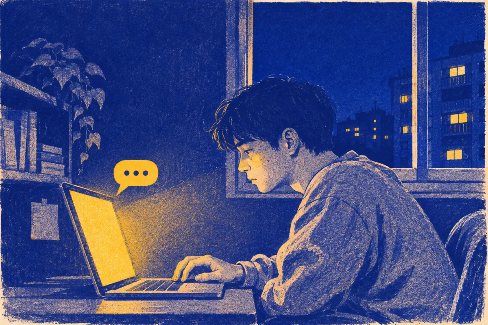
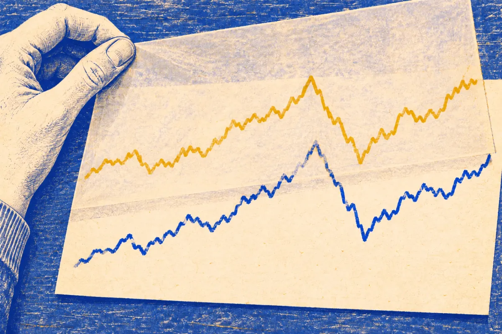
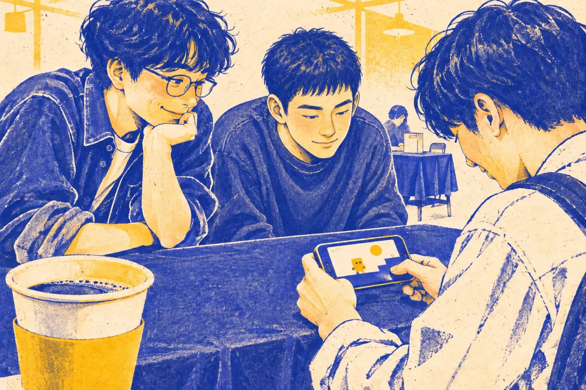

11월 30일이면 첫 회사 아이오트러스트를 떠난다. 3년 5개월을 다녔다. 다음 회사는 정하지 않았다.

퇴사한다는 얘기를 듣고 한 동료가 “평생 여기 계실 줄 알았다”고 했다. 또 한 분은 “기둥이 하나 떠나는구나”라고 했다.

그 말을 듣고 나니 내가 여기서 보낸 시간이 실감 났다. 같이 일한 사람들이 나를 그렇게 봐줬다는 게 참 고마웠다. 떠나기 전에 그 마음을 직접 들을 수 있어서 더 그랬다.

왜 떠나느냐고 물으면 대답할 수 있었다. 이제는 Web3에 예전 같은 확신이 없다고. 그러다 얼마 전, 한 회사에 지원하려고 지원서를 열었다. 거기에 이런 질문이 있었다.

> 꿈이 무엇인가요?

일 얘기를 하다가 갑자기 꿈이라니. 내 꿈을 입 밖에 내려니 낯간지러웠다. 그러면서도 자꾸 그 질문을 생각하게 됐다.

어제는 내가 무엇을 위해 살고 진짜 뭘 바라는지 생각하다가 많이 울었다.

## 그때는 멈췄으면 좋겠다고 했다

지원을 준비하면서 그 팀 사람들이 일에 관해 이야기하는 공개 인터뷰 영상을 봤다. 일을 대하는 태도가 나와 잘 맞을 것 같았고, 이 사람들이라면 정말 큰일을 할 수도 있겠다 싶었다. 특히 ‘낭만’이라는 말이 마음에 남았다. 나는 그 말을 듣고 한창 힘들었던 때를 떠올렸다.

2021년 9월, 동료들과 블록체인 프로젝트를 시작했다. 세 시간 자고 일어나 개발하고, 고객 문의에 답하고, 마케팅도 했다. 사람들이 우리가 만든 걸 계속 즐겼으면 해서 게임 요소도 이것저것 붙였다.

당시 기준으로 1억 원의 수익을 냈다. 그런데 프로젝트가 기대고 있던 클레이튼 생태계가 흔들렸다. 우리가 다음 기능을 아무리 잘 만들어도 서비스를 계속하기 어려워졌다. 이용자들에게 환불하고 2022년 6월에 프로젝트를 접었다.

{: width="1200" height="800" }

그 한가운데 있을 때는 정말 멈췄으면 좋겠다고 생각했다. 평생 이렇게 자고 먹고 개발만 하면서 살아야 한다면 너무 두려웠다.

근데 시간이 흘러서 보니 그때가 그리웠다.

다음에 뭘 만들지 우리끼리 정했고, 그걸 쓰는 사람의 문의에도 우리가 직접 답했다. 다시 세 시간씩만 자고 싶으냐고 하면 고개가 저어진다. 우리 손으로 만든 걸 어떻게든 잘되게 해보고 싶었던 그 마음이 그립다.

이번 달에도 그렇게 마음을 쓴 제품이 있다. 승주 님과 함께 만들어 아이오트러스트에서 출시한 아틀라스다. 가상자산 업계를 떠나기로 한 내가 이 제품만큼은 왜 그렇게 잘 만들고 싶었을까.

## 얘네가 이때 왜 같이 움직였지?

지갑 앱을 만드는 나도 코인 가격을 보고 있으면 막막했다. 어제보다 얼마가 올랐는지는 금방 안다. 그런데 이 프로젝트가 요즘 뭘 해냈는지, 오늘 나온 소식이 이 자산과 무슨 관계인지는 그 숫자에서 잘 읽히지 않았다. 근거가 될 만한 걸 찾으면 나부터 보고 싶었다.

우리는 지갑에서 뉴스를 읽다가 거기 나온 자산의 움직임까지 살펴볼 수 있게 하고 싶었다. 기획부터 디자인, 개발까지 둘이 함께했다. 서로 관련이 있으리라 짐작한 자산들을 같은 섹터로 묶어 봤다.

따로 볼 때는 그저 그날 가격이 오른 자산 몇 개였다. 그런데 같은 시간대에 놓고 보니 몇몇이 비슷한 때에 오르내린 구간이 눈에 들어왔다.

얘네가 이때 왜 같이 움직였지? 그 무렵에 무슨 소식이 있었지?

{: width="1200" height="800" }
_두 자산의 움직임을 겹쳐 본 개념도._

같은 이유로 올랐는지를 알려면 더 알아봐야 했다. 그래도 이제 무엇을 찾아볼지는 알 것 같았다. 지갑을 연 사람도 이 재미를 느꼈으면 했다.

우리는 자산들을 점으로 놓고 관계가 있는 것끼리 선을 이었다. 그 관계를 문단마다 설명하면 만드는 나부터 눈이 피곤했다. 글을 줄이고 그림으로 옮겼다. 시선을 어디로 옮기면 좋을지 애니메이션으로 보여주려 했다.

## 선 하나를 그려도 되는 근거

나는 ‘얘네가 관련이 있지 않을까’ 하고 짐작한 과정까지 안다. 처음 앱을 연 사람 눈에는 점 둘과 그사이를 이은 선 하나만 보인다. 그 사람은 우리가 어디까지 확인했다고 받아들일까.

언어 모델이 어떤 회사를 설명한다면서 그 회사가 만든 제품을 설명한 적이 있었다. 문장이 매끄러워서 그냥 읽으면 넘어갈 만했다. 주어를 다시 짚자 뭐가 잘못됐는지 보였다.

우리는 모델에게 판단의 근거가 된 구절도 내놓게 하고, 그 구절이 원문에 있는지 코드로 대조했다. 판단이 어려운 건 사람에게 넘겼다. 어떤 후보를 왜 버렸는지도 남겼다. ‘판단 보류’라고만 쓰면 다음 사람은 같은 자료를 처음부터 또 읽어야 하니까.

한번은 며칠 전에 확인한 것보다 화면의 설명이 짧아져 있었다. 먼저 받아 둔 답이 내 컴퓨터에만 남아 있어서 서버가 같은 자료를 들고 모델에게 다시 물은 탓이었다.

우리는 확인을 마친 답을 서버에도 저장했다. 같은 질문에 같은 자료가 들어오면 그 답을 다시 썼다. 이제 사용자가 화면을 열면 우리가 미리 읽어본 문장이 나왔다.

지갑을 보면서 뭘 믿어야 할지 막막했던 사람이 나부터였다. 이제는 내가 남의 화면에 설명을 올리는 쪽이었다. 누가 이 말은 어디서 나왔느냐고 물으면 그때 근거로 삼은 기사를 같이 펴보고 싶었다.

## 커피 한 잔 값이어도

지난해 9월쯤 개인사업자를 냈다. 회사를 다니면서 동료들과 게임도 만들고 앱도 만들었다. 벌이를 나누면 한 사람 앞에 한 달에 커피 한 잔 값이었다.

그래도 해커톤에 나가는 게 좋았다. 우리가 만든 걸 들고 부스에 서는 것도 좋았다. 무엇을 만들어서 사람들 앞에 내놓을지 동료들과 정하는 게 재밌었다.

{: width="1200" height="800" }

예전에는 친구가 IPO까지 가보고 싶다고 하면 나는 적당히 돈 되는 작은 사업이면 좋겠다고 했다. 그런데 어느 순간부터는 내가 먼저 상장까지 가는 회사를 만들어보고 싶다고 말하고 있었다.

언제 마음이 바뀌었는지는 모르겠다. 궁금한 문제가 늘었고, 언어 모델 덕분에 예전 같으면 엄두를 못 냈을 일도 해봤다. 커피 한 잔에서 시작한 우리가 어디까지 갈 수 있는지 궁금해졌다.

## 다음 일터로 가져갈 것

퇴사를 결정하고 안정적인 회사에서 경력을 쌓는 길도 생각했다. 다만 한 가지가 걸렸다. 풀고 싶은 문제가 보여도 결정할 권한이 없으면 어쩌지. 몇 번 그러다가 나까지 그냥 지나치는 데 익숙해지면 어쩌지.

나는 의견이 갈리면 시안을 하나 만들어 가는 편이다. 눈앞에 두고 보면 어디를 어떻게 바꾸고 싶은지 묻기가 한결 편하다. 동료도 자기가 보기엔 어느 쪽이 나은지 말해주면 좋겠다. 같은 걸 보고도 생각이 갈리면 거기서부터 이야기할 수 있으니까. 다음 일터에서도 그런 동료와 무엇을 내놓을지 함께 정하고 싶다.

나는 마음을 올바르게 먹고, 생각한 걸 실제로 해보고, 잘 안 풀려도 끈기 있게 붙들면 무엇이든 할 수 있다고 믿는다.

프로젝트를 접어본 사람치고는 큰소리 같기도 하다. 그래도 그때 이용자들에게 환불하는 일까지 마친 우리를 생각한다. 평생 이렇게 살면 어쩌나 하던 내가 몇 년 뒤에는 또 동료들과 게임을 만들었고, 첫 회사를 떠나기 직전까지 지갑에 올라갈 설명을 들여다봤다. 다음에 무슨 일을 할지는 몰라도 내가 그만큼 마음을 줄 수 있는 일이면 좋겠다.

세상을 바꾸는 기술에 내 이름이 들어갔으면 좋겠다.

써놓고 보니 역시 좀 낯간지럽다. 그래도 그대로 두고 싶다. 언젠가 우리가 만든 걸 누군가 자기 일터에서 매일 쓰는 모습을 보고 싶다. 원래는 이 일을 어떻게 하셨는지, 뭐가 달라졌는지 그 사람한테 듣고 싶다. 그때 옆에 그걸 같이 만든 동료가 있으면 좋겠다.

돌아오는 길에 우리 이거 만들길 잘했다고 이야기할 수 있게.
